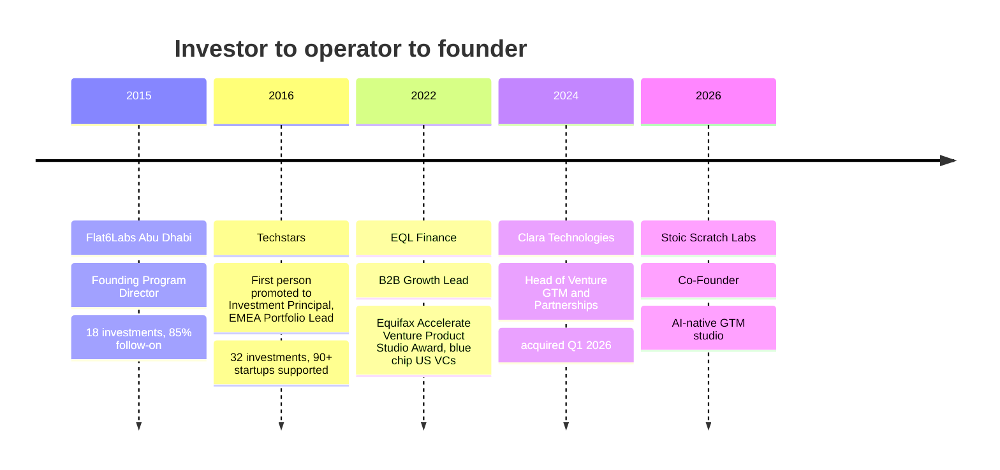
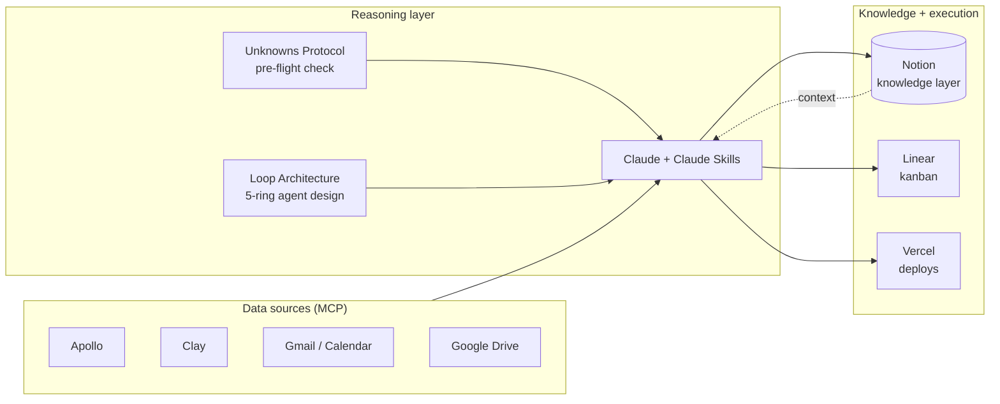
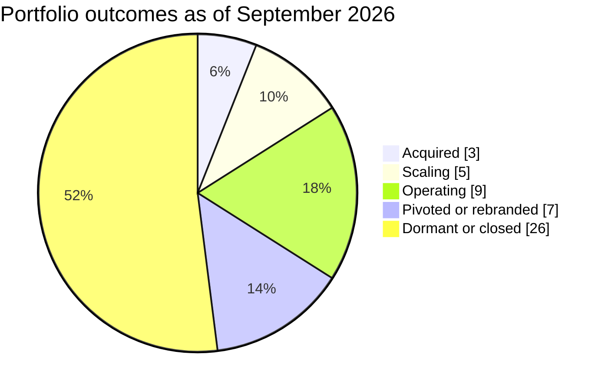

# Ramzy Jamal Ismail

**Investor, founder, operator.**

Co-Founder, Stoic Scratch Labs

---

## About

I've spent ten years on both sides of the startup table.

- **As an investor**, I backed 50 early-stage companies across Techstars and Flat6Labs in the US, Europe, and MENA.
- **As an operator**, I was a senior GTM hire at two venture-backed startups in the US and UAE.
- **As a founder**, I co-founded Stoic Scratch Labs, Venuable (RVA Lighthouse Labs Accelerator, Cohort 1), BetaPetas, and the StartupUAE community.

At **Stoic Scratch Labs**, I build the tools I wish I'd had in both seats: agent workflows, enrichment pipelines, and research systems that help SMB owners and startup founders put AI to work across sales, marketing, and partnerships.

**Open to:** venture investment, partnerships, and GTM leadership roles. Based between Dubai, DC, and Berlin; open to roles in the GCC, US, and Europe.

---

## Track record

**Operational Experience **

- **Clara Technologies (2024 to 2026).** Built Clara Accelerate, a partner program of 20+ accelerators, VCs, and venture studios that grew from 21% to 37% of revenue and lifted partner-sourced pipeline and client onboarding. Built the referral playbook for Hub71 and other partners and ran customer success for all clients. Clara was acquired in Q1 2026.

- **EQL Finance (2022 to 2024).** First commercial hire. Closed partnerships with Equifax and Baltimore Gas and Electric to expand embedded financial access for AI underwriting and lending in underserved communities.

**Investment Experience **

- **Techstars (2016 to 2022).** Techstars' first Investment Principal. Led 32 investments and launched three accelerator investment programs in New York, Baltimore, and the UAE (Area 2071, Dubai). Ran portfolio services for 90+ startups and scaled EMEA portfolio services across 15 accelerator programs from Berlin.

- **Flat6Labs Abu Dhabi (2015 to 2016).** Founding Program Director. Co-built the UAE's first equity-based seed program and a $10M seed fund with twofour54. Made 18 investments across three cycles, including Washmen and [Unnyhog](https://www.ycombinator.com/companies/unnyhog), Abu Dhabi's first Y Combinator company.

---

## Community

I believe in communities and the people who build them. Across cities, I've created spaces where founders and investors connect:

- **StartupUAE:** the first Slack community for UAE startups, bringing together founders, investors, and the MENA diaspora. Hit #1 on Product Hunt for nearly 14 hours, until Product Hunt stopped accepting Slack communities.
- **Berlin 2nd Tuesdays:** a recurring founder, operator, and investor meetup during the years Techstars ran four programs in Berlin.
- **Equitech Happy Hour:** a weekly gathering for Baltimore's tech community.
- **TechFugees Dubai:** technology for displaced people and refugees.

---

- ## Research

I was the kid who took things apart just to see how they worked. Later that turned into breaking down the X's and O's of American football, first as a player and then as a coach. After a short run in equity research, I landed in venture capital, and that's where my curiosity finally had room to roam. 

Early in my work in the UAE, I couldn't connect the stories I was hearing versus the primary data I was finding and trying to build solutions to help the ecosystem:

- **[StartupUAE](https://www.producthunt.com/products/startup-uae/launches/startup-uae) (2015):** Built the first Slack community for connecting the UAE startups across Emirates, a digital home for MENA founders, hackers, investors, and advocates outside the usual forums. It brought in people from across the region and the diaspora, hit #1 on Product Hunt for almost 14 hours (until Product Hunt stopped accepting Slack communities), and Wamda later launched its own version, a good sign the format worked. 

- **Menascapes (2015-16), cited by Forbes and McKinsey:** Before MAGNiTT, PitchBook, and Dealroom made regional data a few clicks away, I co-founded Menascapes with Sharif El-Badawi (then Google's partner lead for VCs and startups) as a volunteer, community-sourced map of the MENA startup ecosystem. I did the research alongside leading Flat6Labs Abu Dhabi, combining MENA PE association data, Wamda, Arabnet research, and conversations with investors and founders, and published it as [Data on Venture Capital in the Middle East](https://medium.com/@ramzyis/data-on-venture-capital-in-the-middle-east-d9004230ebc4), with a focus on the UAE.
  - **[Forbes](https://www.forbes.com/sites/elizabethmacbride/2016/01/18/seeking-untapped-market-nearly-100-investment-funds-emerge-in-middle-east-tech-scene/) (2016):** Used our figures, including 100+ active funds, 75+ accelerators, and $1B+ in available venture capital, to show how fast the region was growing.
  - **[TechWadi](https://www.youtube.com/live/cjagBu23I6A) (2016):** Sharif presented Menascapes as the first webinar for TechWadi's Silicon Valley-based Arab founder and investor network.
  - **[McKinsey](https://www.mckinsey.com/~/media/mckinsey/featured%20insights/Middle%20East%20and%20Africa/How%20investors%20can%20support%20entrepreneurship%20in%20the%20Middle%20East%20and%20North%20Africa/Entrepreneurship-in-the-Middle-East-and-North-Africa.ashx) (2018):** Used our map of incubators, accelerators, and co-working spaces across 10 countries in *Entrepreneurship in the Middle East and North Africa*.
  
- **[Data on Venture Capital in the Middle East](https://medium.com/@ramzyis/data-on-venture-capital-in-the-middle-east-d9004230ebc4) (2016):** My own deep dive into MENA venture capital with a focus on the UAE, done while growing my role at Flat6Labs Abu Dhabi. I pulled together MENA PE association data, Wamda research, and conversations with investors and founders, back before MAGNiTT, PitchBook, and Dealroom made regional data was available. Final data was presented to ADIC in UAE.

---

## Shipped work

| Project | What it does | Stack | Status |
|---|---|---|---|
| **`job-search-workflow`** | 7-phase career coaching pipeline: CV audit, rewrite, gap analysis, company research, interview prep, strategy | Claude Skills | Shipped |
| **`loop-architecture`** | Pre-build design pass for agentic systems using a 5-ring loop taxonomy, so agents are designed before they're coded | Claude Skills | Shipped |
| **`finding-your-unknowns`** | 4-move pre-flight check that surfaces hidden assumptions before any build starts | Claude Skills | Shipped |
| **`write-clearly`** | Clear-writing framework (after Edward T. Thompson) that auto-triggers on application and outreach copy | Claude Skills | Shipped |
| **GTM Systems Library** | Outbound and partner GTM for B2B startups entering the US and GCC: enrichment, sequencing, WhatsApp-first and PDPL-safe LinkedIn motions, full SOP set | Clay, n8n, WhatsApp Business API, Notion | In use |
| **MENA Signal Pipeline** | Turns raw WhatsApp community exports into a funding and regulation signal report, with a Notion regulatory register that new exports append to | Claude, Notion API | In progress |
| **MENA AI Consumer Operating Model** | 12-tab, 10,000+ formula operating model for AI subscription businesses across three Middle East markets: two-tier churn, Saudization and GOSI, Zakat, three scenarios | Excel | Shipped |
| **AI-Native Job Search System** | Role-specific CVs, cover letters, referral mapping, and outreach drafts generated from one locked fact sheet | Claude, Gmail MCP | In use |
| **PATCH NYC Hackathon 2025** | Terminal-style financial data tool for SMBs | TypeScript | Hackathon |

---

## How I build

1. **Find the unknowns first.** Every build starts with a pre-flight check on assumptions, constraints, and what "done" means.
2. **Design the loop before the agent.** Map inputs, decisions, feedback, and failure modes before writing a prompt.
3. **Measure the delta.** Trace logs, error analysis, and before-and-after measurement, or it didn't happen.
4. **Make it multiplayer.** Tools should work for a team, not just for me.
5. **Ship in public.** Work that lives in a private doc can't help anyone else.

## RAM_OS: the system behind the work

A set of Claude Skills, live MCP connections, and protocols that let one operator run like a small team.

---

## Toolbox

| Layer | Tools |
|---|---|
| **AI and agents** | Claude, Claude Code, Claude Skills, MCP, Lovable, Replit |
| **GTM data and automation** | Apollo, Clay, n8n, WhatsApp Business API, HubSpot, Salesforce |
| **Knowledge and ops** | Notion, Linear, Google Workspace, Vercel |
| **Certifications** | [AWS Certified AI Business Strategist (2026)](https://www.credly.com/badges/2378787c-e42f-439f-913b-bb10c3e25a3a/public_url), Pendo AI for Product Management (2025) |

---

## Institutional Investment record

50 early-stage investments across four accelerator programs on three continents, 2015 to 2022.

| Metric | Value |
|---|---|
| **Companies backed** | 50, with founders from 17 countries |
| **Follow-on capital raised by the portfolio** | $65M+ in publicly disclosed rounds |
| **Acquisitions** | 3, with buyers including NielsenIQ and AB InBev's ZX Ventures |
| **Still operating, pivoted, or exited** | 24 of 50 (48%) |
| **MENA-origin companies** | 17 |

| Program | Year | Companies | Still operating or exited | Capital raised since |
|---|---|---|---|---|
| Flat6Labs Abu Dhabi (3 cycles) | 2015 to 2016 | 18 | 5 | $8.6M |
| Techstars Connection, New York (with AB InBev) | 2016 | 10 | 4 | $21.0M |
| Techstars Dubai (Area 2071) | 2018 | 10 | 6 | $12.6M |
| Techstars Equitech, Baltimore | 2022 | 12 | 9 | $22.8M |

### Highlights

**Exits**
- **Gastrograph AI** (Analytical Flavor Systems, Techstars 2016): acquired by NielsenIQ in April 2025, after a Series A co-led by Leawood VC and Global Brain and a strategic round from Sony.
- **Intelligent Layer** (Techstars 2016): acquired by ZX Ventures, AB InBev's innovation arm and the program's own corporate partner.

**Breakouts**
- **Washmen** (Flat6Labs 2015): the fastest company out of Flat6Labs Abu Dhabi to raise. Its $6.2M Series B was led by AddVenture with Henkel as a strategic investor, and the CEO reported its first profitable year in 2023.
- **Octi, now Ultraviolet Social** (Techstars 2016): raised $12M from Live Nation, AB InBev, Bold Capital and others, the largest raise in the portfolio.
- **Paperstack** (Techstars 2022): $10.4M raised and $30M+ originated to e-commerce and CPG brands, with sub-1% defaults.
- **EcoMap Technologies** (Techstars 2022): $10.4M raised to map and measure 100+ entrepreneurial ecosystems.
- **Klasha** (Techstars Dubai 2018): pivoted into cross-border payments. Its $2.4M seed was led by Greycroft and extended by Amex Ventures in Amex's first African investment.
- **Natufia Labs** (Techstars Dubai 2018): relocated to Saudi Arabia on a $3.5M Series A led by the KAUST Innovation Fund.
- **Narrativa** (Flat6Labs 2016): pivoted into generative AI for pharma regulatory writing and relocated to Santa Monica.

**Founders who went on to scale**
- **Abdulhamid Hassan** (Skylar Labs, Flat6Labs Abu Dhabi 2016) went on to found Mono, Africa’s open-banking infrastructure company. It raised $17.6M from Tiger Global, General Catalyst, and Y Combinator, and Flutterwave acquired it in 2026.
- **Cody Candee** (Intelligent Layer, Techstars 2016) founded Bounce, a global luggage-storage network spanning 4,000+ cities. It raised $34.2M from Andreessen Horowitz, General Catalyst, and Sapphire Sport.
- **Valerie Konde** (Collectionair, Flat6Labs Abu Dhabi 2015) co-founded Pemo, the Dubai-based spend management platform. It raised $19M from Shorooq, Cherry Ventures, and Augmentum Fintech. 

**Investor to operator.** I backed EQL Finance in Techstars Equitech's inaugural 2022 class, then joined the company as its first commercial hire.

Figures reflect publicly disclosed funding as of September 2026. Companies with undisclosed rounds are counted at zero, so totals understate capital raised.

**Recruiters and hiring teams:** the fastest way to reach me is [email](mailto:Ramzytoday@gmail.com) or [LinkedIn](https://www.linkedin.com/in/ramzyis/).

**Founders:** I'm glad to help with GTM, US and GCC market expansion, fundraising, and community-led sales.

Always building, testing, and fiddling with things.

